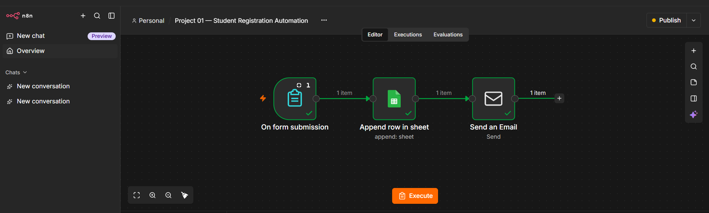
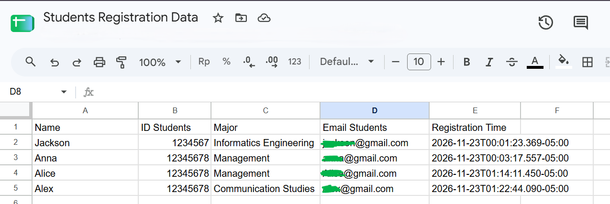
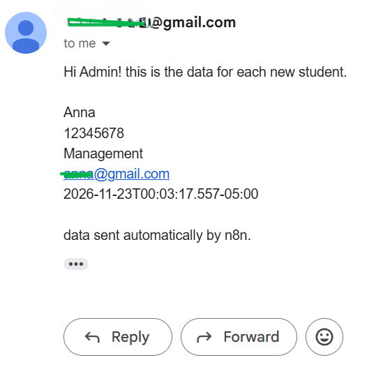

# 🎓 Student Registration Automation

My first beginner-level workflow automation project built using **n8n**.

## 📌 Project Overview

Student Registration Automation is a workflow designed to simplify the student registration process by connecting an online form, Google Sheets, and Gmail.

## 🔴 Problem

Manual student registration requires administrative staff to:
- Collect student information.
- Record registration data manually.
- Send confirmation emails individually.

This process can be time-consuming and repetitive.

## 🟢 Solution

I built an automated workflow using n8n with three main steps:

1. **Form Trigger:** Receives student registration submissions.
2. **Google Sheets:** Automatically stores student information in a spreadsheet.
3. **Gmail:** Sends an email notification after registration.

## 🔄 Workflow Architecture

Form Trigger → Google Sheets → Gmail

## 📊 Result

The workflow was successfully executed during testing.

- Registration data was received successfully.
- Google Sheets successfully processed the append-row operation.
- Gmail returned a successful SMTP response (`250 2.0.0 OK`).

## 🛠️ Tools & Technologies

- n8n
- Google Sheets
- Gmail

## 📚 What I Learned

- Basic workflow automation.
- Using triggers in n8n.
- Connecting applications.
- Mapping data between nodes.
- Automated email notifications.
- Testing workflow executions.

**Project Level:** Beginner

**Project Status:** Completed and tested.

## 📸 Project Evidence

### 1. Workflow Overview

### 2. Google Sheets Registration Data

### 3. Email Confirmation

